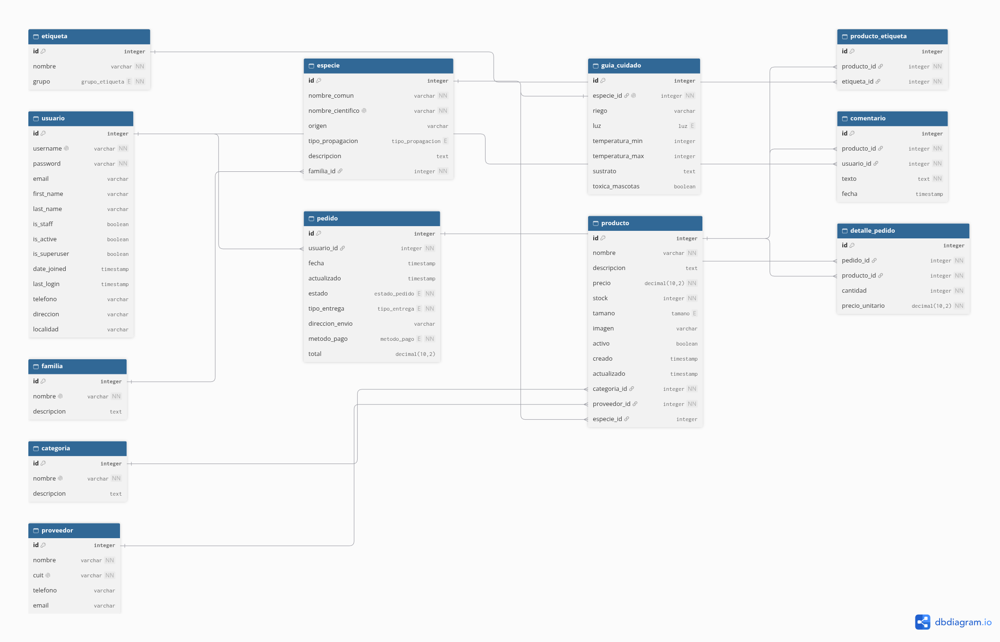
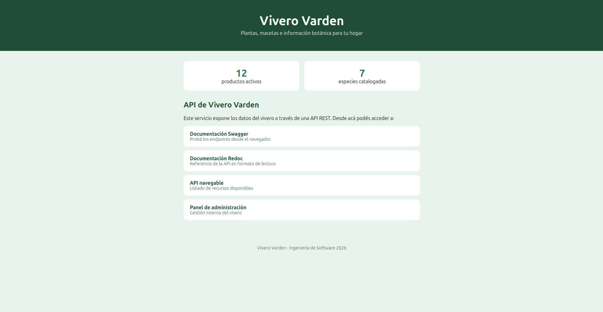
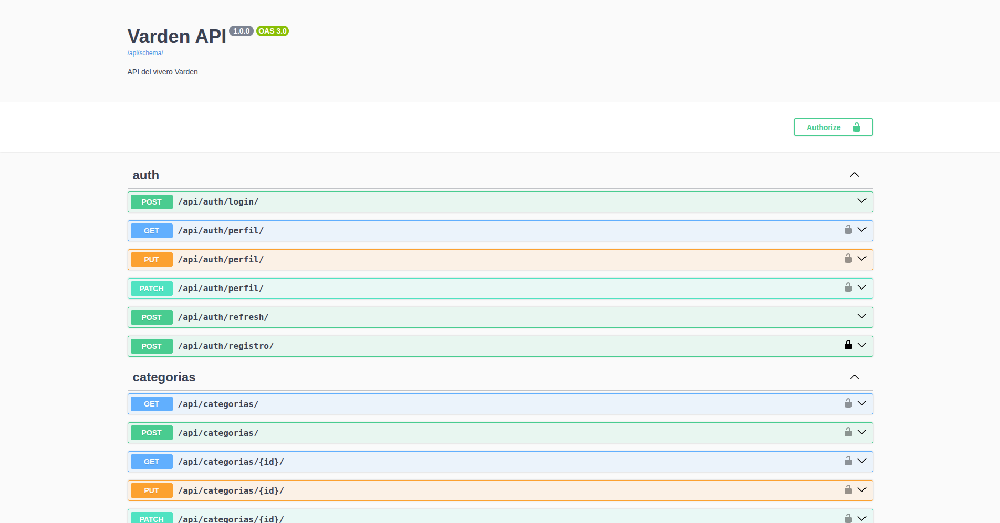
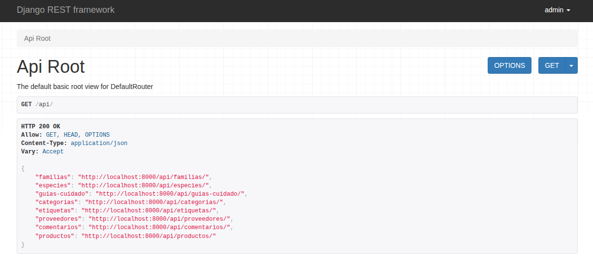
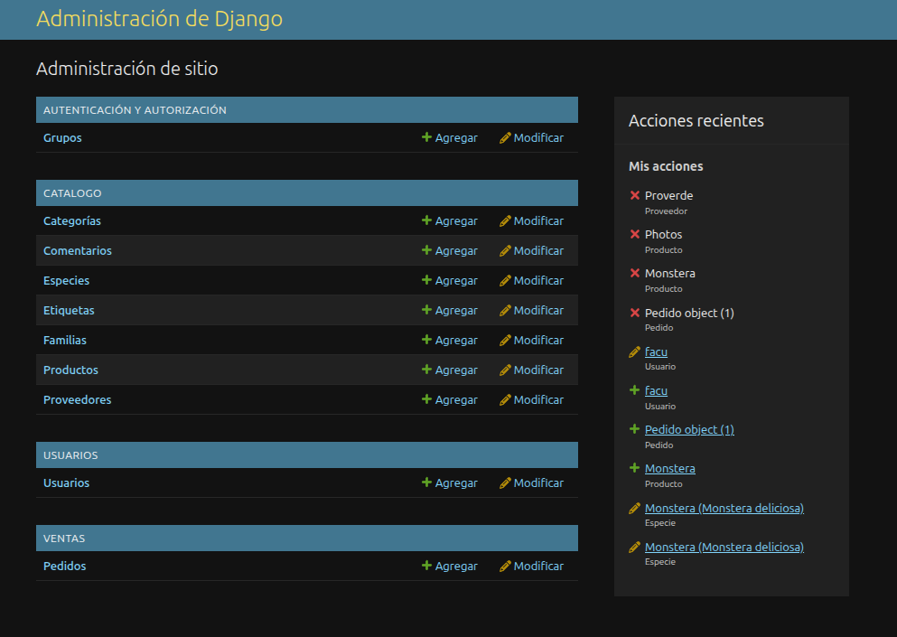

# Vivero Varden

API REST para la gestión y consulta de un vivero: catálogo de plantas y productos,
información botánica de cada especie, comentarios de los clientes y pedidos.
Proyecto de la Evaluación Final Integradora de Ingeniería de Software (2026).

**Integrantes:** Facundo Puig, Gonzalo Riva

## Tecnologías

Python 3.12 · Django · Django REST Framework · JWT (simplejwt) · PostgreSQL ·
Docker y Docker Compose · uv · drf-spectacular

## Planificación de la base de datos



| Modelo | Descripción |
|---|---|
| Usuario | Cuenta de acceso (hereda de AbstractUser) con teléfono, dirección y localidad |
| Familia | Familia botánica (Aráceas, Cactáceas...) |
| Especie | Ficha botánica: nombre común y científico, origen, propagación |
| GuiaCuidado | Riego, luz, temperatura y toxicidad. Una por especie |
| Categoria | Tipo de producto (Plantas, Árboles, Macetas...) |
| Etiqueta | Atributos agrupados: ubicación, clima, tipo de planta y uso |
| Proveedor | Datos de contacto internos del vivero |
| Producto | Lo que se vende. Puede o no estar asociado a una especie |
| Comentario | Opiniones de los usuarios sobre un producto |
| Pedido | Compra de un usuario |
| DetallePedido | Renglones de cada pedido |

## Cómo levantar el proyecto

Requisitos: Docker, Docker Compose y Git.

```bash
git clone https://github.com/facundo-puig/Vivero-Varden.git
cd Vivero-Varden
cp .env.example .env
docker compose up -d --build
docker compose exec web python manage.py createsuperuser
docker compose exec web python manage.py cargar_datos
```

| Dirección | Qué es |
|---|---|
| http://localhost:8000/ | Página de bienvenida |
| http://localhost:8000/api/docs/ | Documentación Swagger |
| http://localhost:8000/api/redoc/ | Documentación Redoc |
| http://localhost:8000/api/ | API navegable |
| http://localhost:8000/admin/ | Panel de administración |

**API en producción:** https://vivero-varden-api.onrender.com/api/docs/

Para apagarlo: `docker compose down`.

## Variables de entorno

Ver `.env.example`. Las principales: `SECRET_KEY`, `DEBUG`, `ALLOWED_HOSTS`,
`CORS_ORIGINS` y los datos de PostgreSQL.

## Autenticación y permisos

- Registro: `POST /api/auth/registro/`. Login: `POST /api/auth/login/` (devuelve `access` y `refresh`).
- Enviar el token como `Authorization: Bearer <access>`. También funciona la sesión.
- Catálogo y productos: lectura pública, escritura solo para staff.
- Proveedores: solo staff. Comentarios: cada usuario edita y borra solo los suyos.

## Endpoints principales

| Recurso | Ruta | Destacado |
|---|---|---|
| Productos | `/api/productos/` | Anidado en el listado, filtros, búsqueda, orden, `bajo_stock/` |
| Especies | `/api/especies/` | Anidado en el listado, búsqueda, `cuidados/` |
| Familias, categorías, etiquetas, guías | `/api/...` | |
| Comentarios | `/api/comentarios/` | Filtro por producto |
| Perfil | `/api/auth/perfil/` | |

## Capturas






## Proceso de trabajo

Git con GitFlow (`main`, `develop` y ramas `feature/*`), pull requests por cada
funcionalidad y commits descriptivos.